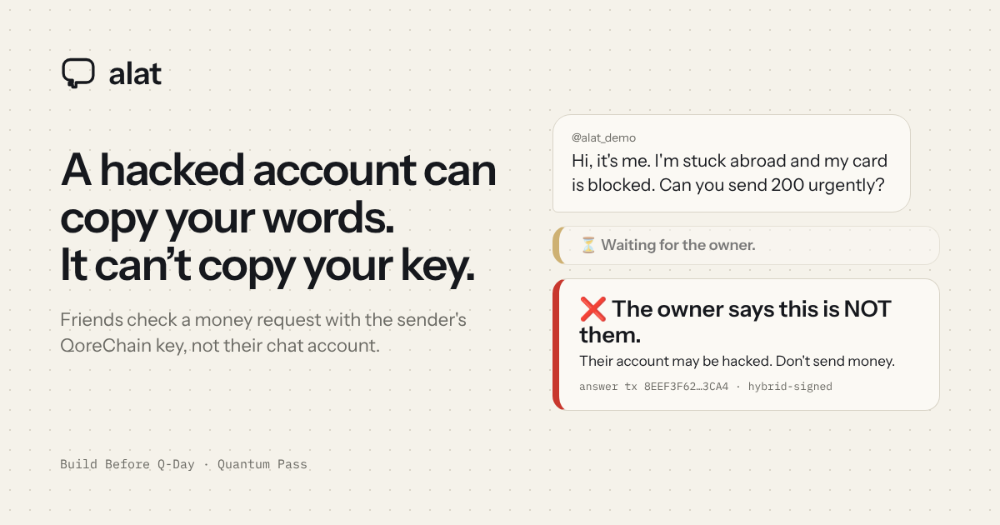

# Alat

**A hacked account can copy your words. It can't copy your key.**

Alat lets a friend check a money request with the sender's QoreChain key, held in QoreX, instead of trusting the chat account a hacker may have taken over.

**Live site:** not deployed yet · **Telegram bot:** not deployed yet · **Judge page:** `/judge` on the live site · **Demo video:** not published yet · **Hybrid-signed tx:** [`D17E9DDC…8162`](https://api-testnet.qore.host/cosmos/tx/v1beta1/txs/D17E9DDC1DAD4D8AEF248B6E1C3EC46C43076DF81A8705BB8D8476CC8B1D8162)



Built for **Build Before Q-Day: the QoreChain Developer Fest**, category **Quantum Pass**.

## The problem

Someone's Telegram gets hacked, and the hacker messages all their friends: *"I'm stuck, please send money urgently."* It works because the hacker owns the account, the name and the chat history. Friends have no way to check.

## For judges: start here

| Do this | You'll see |
| --- | --- |
| 1. Open `/judge` and press **Get the hacker's message** | A money request from `@alat_demo` and a ⏳ *Waiting for the owner* card |
| 2. Press **Answer "yes" with the hacker's key** | A real testnet transaction from a different registered key, **refused**: *signed by a different key than the one linked* |
| 3. Press **No, that's not me** | The card turns ❌ *The owner says this is NOT them*, with the answer transaction |
| 4. Press **A real request from the owner**, then **Yes, that's me** | ✅ *Confirmed by the real owner* |
| 5. Read the proof numbers at the top and the **What Alat refuses** table | Counts read live from the registry contract; each refusal links its test |
| 6. In Telegram (once the bot is live): send `/demo` to the bot | The same check in a chat, one message that changes from ⏳ to ❌ or ✅ |

No QoreX is needed for this: the demo account's key is held by the Alat server (the page says so), and every answer is still a real hybrid-signed testnet transaction checked by the same code as a real owner's. All steps were run on the testnet; see [docs/testnet-log.md](docs/testnet-log.md).

## How it works

```
 LINK (once)                       CHECK                                 RESPOND (owner, outside the chat)
 ───────────                       ─────                                 ─────────────────────────────────
 owner ──/link──▶ bot              friend ──/check @owner──▶ bot         owner ──▶ alat /respond ──▶ QoreX
 bot ──one-time link (10 min)──▶   (or forwards the message)             QoreX signs a 1 uqor self-transfer,
 owner opens it, connects QoreX    bot: ⏳ "Do not send money until       memo "alat1:ans:<nonce>:yes|no",
 QoreX signs a 1 uqor self-send,        this turns green"                secp256k1 + ML-DSA-87
 memo "alat1:link:<hash>:<token>"  (15 min to answer)                    server reads the tx from chain,
 server reads it from chain ──▶                                          checks signer = linked owner,
 relayer writes AlatRegistry:                                            hybrid verified, nonce, expiry
 HMAC(salt, telegram id) → owner                                         bot edits the friend's message:
                                                                         ✅ / ❌ not me / ❌ expired
```

- **Why a transaction and not a signed message:** QoreX can't sign messages yet, only hybrid-signed native transactions. The memo carries the action, the chain verifies both signatures, and Alat re-verifies the ML-DSA-87 signature against the key registered on chain. Every answer is public and re-checkable. See [docs/FINDINGS.md](docs/FINDINGS.md).
- **Re-link protection is in the contract:** once linked, moving the account to another key waits **7 days** on chain, shows "⚠️ link change pending" on every check, and can be cancelled by the current key. A hacker with the Telegram account alone can't swap the key.
- **Privacy:** the chain stores a salted hash of the Telegram id, never the id, username or request text.

More: [threat model](docs/threat-model.md) · [status](https://github.com/ahmardchain/alat/blob/main/apps/web/src/pages/Status.tsx) (served at `/status`).

## Requirements checklist

| Requirement | Proof |
| --- | --- |
| Scaffolded with `create-qorechain-dapp` | `npx create-qorechain-dapp@0.14.0 web -t viem-wagmi` and `contracts -t hardhat` (commit `f2ae812`) |
| QoreX wallet connect on the website | `/link`, `/respond`, `/wallet`: [`apps/web/src/lib/qorex.ts`](apps/web/src/lib/qorex.ts); test [`apps/web/e2e/wallet.spec.ts`](apps/web/e2e/wallet.spec.ts) |
| Deployed on QoreChain testnet | AlatRegistry [`0x431da38e11e27ba0e74ba06a4fbce7b86d1570ec`](https://explore.qore.network/address/0x431da38e11e27ba0e74ba06a4fbce7b86d1570ec) (select Testnet) |
| Hybrid-signed (secp256k1 + ML-DSA-87) transaction | [`D17E9DDC1DAD4D8AEF248B6E1C3EC46C43076DF81A8705BB8D8476CC8B1D8162`](https://api-testnet.qore.host/cosmos/tx/v1beta1/txs/D17E9DDC1DAD4D8AEF248B6E1C3EC46C43076DF81A8705BB8D8476CC8B1D8162): `pqc_hybrid_verify: verified`, 4,627-byte ML-DSA-87 signature. Every link and answer since is hybrid-signed too. |
| Public repo, MIT licence | [LICENSE](LICENSE) |
| README, featured image, video ≤ 3 min | this file, [docs/featured.png](docs/featured.png), video: not published yet ([script](docs/demo-script.md)) |
| Every testnet address listed | [Testnet addresses](#testnet-addresses) |
| Every kit, template and library credited | [Credits](#credits) |
| AI_USAGE.md | [AI_USAGE.md](AI_USAGE.md) |

## What Alat refuses

| Refused | Test |
| --- | --- |
| A signature from a different key | [`packages/core/test/verify.test.ts`](packages/core/test/verify.test.ts) "refuses a signature from a different key"; on testnet: `DBE276F5…458C`, `4BC06823…41E4` |
| A replayed signature from an older check | same file, "refuses a replayed signature from an older challenge (nonce)" |
| A signature valid for one account used on another | same file, "refuses a signature valid for one account used on another" |
| Re-link from Telegram alone, without the old key | [`contracts/test/AlatRegistry.ts`](contracts/test/AlatRegistry.ts) "stays pending for 7 days and the old owner stays linked"; flagged on every check: [`apps/server/test/service.test.ts`](apps/server/test/service.test.ts); on testnet: request `F9E471C9…6D79`, cancel `24D5AC9A…9529` |
| An expired check answered late | [`apps/server/test/service.test.ts`](apps/server/test/service.test.ts) "keeps an expired challenge answered late at ❌" |
| A transaction without a valid hybrid signature | [`packages/core/test/observe.live.test.ts`](packages/core/test/observe.live.test.ts) "sees that a classical transaction carries no hybrid layer" |

## Testnet addresses

Network `qorechain-diana` (EVM chain id 9800). Explorer: <https://explore.qore.network>, select **Testnet**.

| What | Address |
| --- | --- |
| AlatRegistry | `0x431da38e11e27ba0e74ba06a4fbce7b86d1570ec` |
| Relayer (only writer of the registry) | `qor1md44fjsld8rjzx2r2hhyquw2wldm60a2dqlalk` / `0xdb6B54Ca1F69c721194355EE4071Ca77dbbd3faa` |
| Demo owner (`@alat_demo` on /judge, key held by the server) | `qor1psnx8dzwy3trwqg279zzr93l5ksd2ktgnsgp40` / `0x0C2663b44E245637010AF14421963FA5a0D55968` |
| Test owner (QoreX wallet mock in e2e tests) | `qor1zrmp2jdwfq8kdv4u7ug5n7xvqnl8lpnl7s3etz` |
| PQC Key Status precompile (read by the contract) | `0x0000000000000000000000000000000000000a02` |

Every transaction: [docs/testnet-log.md](docs/testnet-log.md).

## Run it locally

Needs Node 22.13+ and pnpm. Fill `.env` with a 32+ character `ALAT_ID_SALT` and a funded testnet `ALAT_RELAYER_MNEMONIC` (`pnpm --filter @alat/contracts ops keys` creates one).

```bash
git clone https://github.com/ahmardchain/alat && cd alat
pnpm install
cp .env.example .env
pnpm --filter @alat/web build
pnpm --filter @alat/server dev
```

Open <http://localhost:8787/judge>. Tests: `pnpm test` (live chain tests: `pnpm --filter @alat/core test:live`, `pnpm --filter @alat/web e2e:live`).

## Credits

| Used | For |
| --- | --- |
| [create-qorechain-dapp](https://www.npmjs.com/package/create-qorechain-dapp) 0.14.0, templates `viem-wagmi` and `hardhat` | the starter for `apps/web` and `contracts` |
| [@qorechain/sdk](https://www.npmjs.com/package/@qorechain/sdk) 0.14.0 | accounts, hybrid native signing (`EthNativeSigner`), PQC key registration, EVM window messages |
| [@qorechain/evm](https://www.npmjs.com/package/@qorechain/evm) 0.14.0 | EVM window status and cost |
| [@qorechain/qoresign](https://www.npmjs.com/package/@qorechain/qoresign) 0.2.0 | `inspectTransaction`: re-verifying the ML-DSA-87 layer against the registered key |
| [@qorechain/qorex-types](https://www.npmjs.com/package/@qorechain/qorex-types) 0.1.0 | QoreX detection and `signAndBroadcast` |
| [@qorechain/qorex-wallet-mock](https://www.npmjs.com/package/@qorechain/qorex-wallet-mock) 0.1.0 | end-to-end tests with real hybrid signing |
| QoreChain PQC Key Status precompile | the contract's on-chain ML-DSA-87 key check |
| [viem](https://viem.sh), [CosmJS](https://github.com/cosmos/cosmjs), [cosmjs-types](https://github.com/confio/cosmjs-types) | EVM and native-lane clients |
| [Hardhat 3](https://hardhat.org) | contract build and tests |
| [Hono](https://hono.dev), [grammY](https://grammy.dev), Node `node:sqlite` | server, Telegram bot, storage |
| [React](https://react.dev), [Vite](https://vitejs.dev), [Playwright](https://playwright.dev) | site and browser tests |
| [@scure/base](https://github.com/paulmillr/scure-base), [tsx](https://tsx.is) | bech32, running TypeScript |
| [Instrument Sans](https://fonts.google.com/specimen/Instrument+Sans), [IBM Plex Mono](https://fonts.google.com/specimen/IBM+Plex+Mono) (Google Fonts) | type |
| Claude Code (Anthropic) | AI coding agent, see [AI_USAGE.md](AI_USAGE.md) |

## Status and next steps

Every feature, the date it went live, its evidence and what's still open: `/status` on the site. Known limits are in the [threat model](docs/threat-model.md).

Next: WhatsApp and Instagram (no bot sees a user id there, so linking needs another proof), family groups where one check notifies several people, and answers by QoreSign message proofs once QoreX can sign messages.

Licence: MIT.
